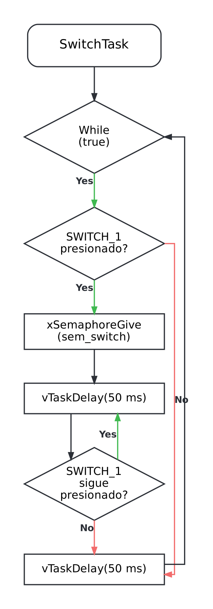
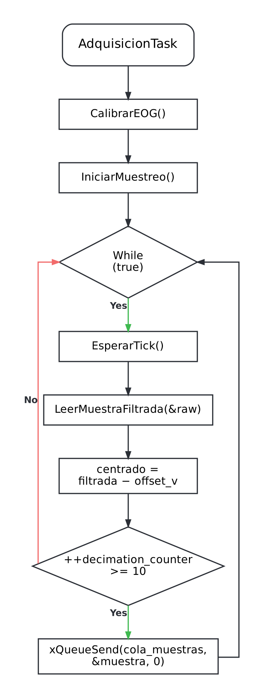
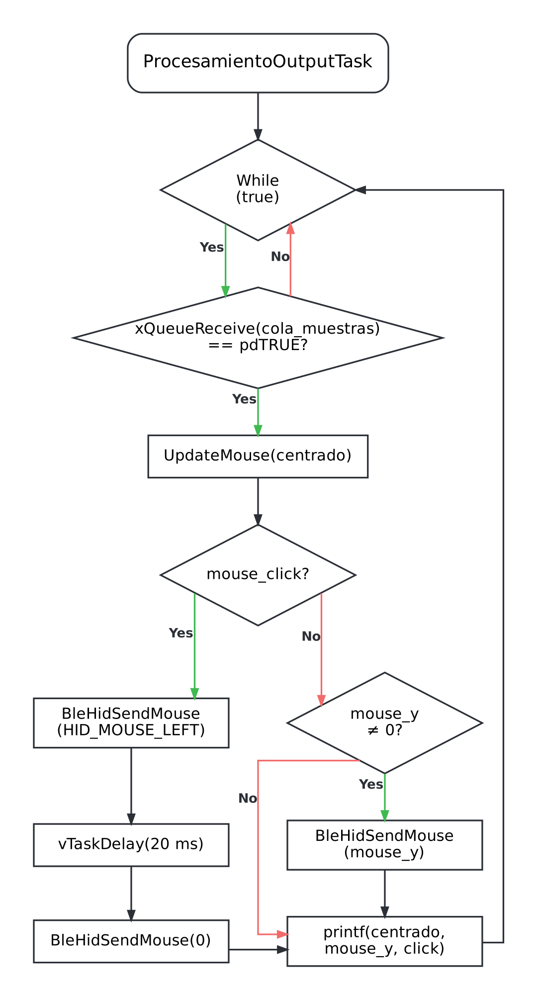
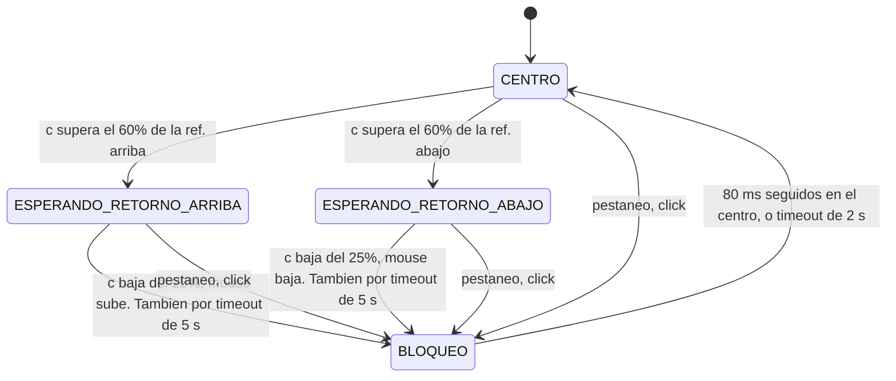

# Mouse Bluetooth controlado por EOG (ESP32-C6)

Firmware en C para una **ESP32-C6** que adquiere una señal de **electrooculografía (EOG)** mediante electrodos y traduce los movimientos del ojo en acciones de un **mouse Bluetooth (BLE HID)** para controlar una PC.

- **Mirar arriba y volver al centro** → el cursor se mueve hacia arriba.
- **Mirar abajo y volver al centro** → el cursor se mueve hacia abajo.
- **Pestañear con firmeza** → click izquierdo.

Archivo principal: `proyecto_integrador.c`

---

## Características

- Muestreo a **1 kHz** con un timer de hardware (`timer_mcu`) y lectura del ADC.
- Filtro IIR **pasa-bajos de 28 Hz, orden 2**.
- **Decimación a 100 Hz** (factor 10) antes del procesamiento.
- **Calibración guiada de 40 s** (4 etapas de 10 s) que se adapta a cada usuario y a cada colocación de electrodos.
- La referencia de cada gesto es el **promedio de los picos individuales** detectados, no el máximo absoluto, lo que la hace más robusta frente a un pico aislado.
- Un movimiento se emite **al volver al centro**, y luego hay un **bloqueo** hasta que la señal se estabiliza. Así el rebote del movimiento anterior no cuenta como otro.
- Salida por puerto serie en formato CSV para graficar la señal y los eventos.

---

## Hardware y dependencias

| Elemento | Detalle |
|---|---|
| Microcontrolador | ESP32-C6 |
| Entrada de señal | Canal ADC `CH3` (modo `ADC_SINGLE`), con la señal EOG ya acondicionada |
| Pulsador | `SWITCH_1`, para avanzar en la calibración |
| Sistema operativo | FreeRTOS (ESP-IDF) |
| Bluetooth | BLE HID, dispositivo `EOG_Mouse` |

Módulos utilizados: `timer_mcu`, `analog_io_mcu`, `switch`, `iir_filter`, `ble_hid_mcu`.

---

## Arquitectura

El sistema se divide en 3 tareas de FreeRTOS más una ISR de timer.

| Tarea | Prioridad | Stack | Función |
|---|:---:|:---:|---|
| `AdquisicionTask` | 5 | 8192 | Calibra, muestrea a 1 kHz, filtra, centra y envía muestras decimadas a la cola |
| `ProcesamientoOutputTask` | 3 | 4096 | Recibe muestras a 100 Hz, ejecuta la máquina de estados y envía los eventos de mouse por BLE |
| `SwitchTask` | 2 | 2048 | Antirrebote de `SWITCH_1`; libera un semáforo en cada pulsación |

```
Timer 1 kHz ──ISR──▶ AdquisicionTask ──cola (100 Hz)──▶ ProcesamientoOutputTask ──BLE HID──▶ PC
                          ▲
SWITCH_1 ──▶ SwitchTask ──┘ (semáforo, usado en la calibración)
```

- La **ISR del timer** (`TimerMuestreoISR`) solo notifica a `AdquisicionTask` con `vTaskNotifyGiveFromISR`.
- La **cola** `cola_muestras` tiene 32 elementos de tipo `muestra_eog_t` (`raw` y `centrado`).

### Diagramas de flujo

| Tarea | Diagrama |
|---|---|
| `SwitchTask` |  |
| `AdquisicionTask` |  |
| `ProcesamientoOutputTask` |  |

---

## Calibración

Al encender, `AdquisicionTask` ejecuta `CalibrarEOG()`. Cada etapa dura **10 s** y comienza al presionar `SWITCH_1`. Al inicio de cada etapa se descartan 200 muestras para que el filtro IIR se asiente.

| Paso | Qué hacer | Qué se obtiene |
|:---:|---|---|
| 1/4 | Mirar al frente en reposo | `offset_v` (promedio) y `ruido_sigma` (desvío estándar) |
| 2/4 | Mirar **arriba** y volver al centro repetidamente | `umbral_arriba_ref` (pico promedio, positivo) |
| 3/4 | Mirar **abajo** y volver al centro repetidamente | `umbral_abajo_ref` (pico promedio, negativo) |
| 4/4 | **Pestañear** firmemente de forma repetida | `umbral_pestaneo_ref` (pico promedio, positivo) |

**Detección de picos:** un pico empieza cuando la señal supera `K_RUIDO_DETECCION × sigma` (con un piso de `UMBRAL_DET_MIN_CUENTAS`) y termina cuando cae por debajo de la mitad de ese umbral. Si se detectan menos de `PICOS_MIN_VALIDOS` picos, se avisa por terminal y se usa el máximo absoluto.

**Validaciones al final:** se advierte por terminal si algún signo es inesperado (arriba > 0, abajo < 0, pestañeo > 0), lo que suele indicar polaridad de electrodos invertida. También se advierte si el pestañeo no supera claramente a la mirada arriba, porque podrían generarse clicks involuntarios.

Al terminar se inicia el servicio BLE HID con el nombre **`EOG_Mouse`**.

---

## Operación: máquina de estados

`UpdateMouse()` se llama a 100 Hz con la señal centrada (`c = filtrada − offset_v`).



| Evento | Condición | Acción |
|---|---|---|
| Movimiento arriba | Supera `FRAC_DETECCION × ref_arriba` y luego baja de `FRAC_RETORNO × ref_arriba` | `mouse_y = -PASO_MOUSE_PX` (cursor sube) |
| Movimiento abajo | Supera `FRAC_DETECCION × ref_abajo` y luego sube de `FRAC_RETORNO × ref_abajo` | `mouse_y = +PASO_MOUSE_PX` (cursor baja) |
| Click | `c > FRAC_PESTANEO × ref_pestañeo` (en cualquier estado salvo `BLOQUEO`) | Botón izquierdo presionado `CLICK_PULSO_MS` ms |

Si la mirada se sostiene más de `ESPERA_RETORNO_MAX` muestras (5 s), el movimiento se descarta. El estado `BLOQUEO` también tiene un seguro: se rearma solo tras `BLOQUEO_MAX_MUESTRAS` (2 s).

---

## Parámetros configurables

Todos están como `#define` al inicio del archivo.

| Parámetro | Valor | Descripción |
|---|:---:|---|
| `SAMPLE_FREQ` | 1000 Hz | Frecuencia de muestreo |
| `DECIMATION_FACTOR` | 10 | Salida a 100 Hz |
| `CALIB_SEC` | 10 s | Duración de cada etapa de calibración |
| `WARMUP_MUESTRAS` | 200 | Muestras descartadas al iniciar cada etapa |
| `K_RUIDO_DETECCION` | 5.0 | Umbral de detección de picos = K × sigma |
| `UMBRAL_DET_MIN_CUENTAS` | 30 | Piso del umbral de detección |
| `PICOS_MIN_VALIDOS` | 3 | Mínimo de picos para usar el promedio |
| `FRAC_DETECCION` | 0.6 | Fracción del pico promedio que activa arriba/abajo |
| `FRAC_RETORNO` | 0.25 | Fracción por debajo de la cual se considera "volvió al centro" |
| `FRAC_PESTANEO` | 0.6 | Fracción del pico de pestañeo que activa el click |
| `REARME_MUESTRAS` | 8 (80 ms) | Muestras seguidas en el centro para rearmar |
| `BLOQUEO_MAX_MUESTRAS` | 200 (2 s) | Rearme forzado |
| `ESPERA_RETORNO_MAX` | 500 (5 s) | Máximo de tiempo con la mirada sostenida |
| `PASO_MOUSE_PX` | 20 | Desplazamiento por movimiento completado |
| `CLICK_PULSO_MS` | 20 ms | Duración del click |
| `QUEUE_LEN` | 32 | Largo de la cola de muestras |

---

## Uso

1. Colocar los electrodos y conectar la señal EOG al canal ADC `CH3`.
2. Compilar y flashear el firmware a la ESP32-C6, y abrir el monitor serie.
3. Seguir las instrucciones de la terminal y presionar `SWITCH_1` al inicio de cada una de las 4 etapas de calibración.
4. Cuando termine la calibración, vincular la PC o el móvil al dispositivo Bluetooth **`EOG_Mouse`**.
5. Controlar el cursor con los movimientos oculares y los pestañeos.

### Salida serie en operación

Cada muestra a 100 Hz se imprime como una línea CSV:

```
centrado,mouse_y,click
```

| Campo | Descripción |
|---|---|
| `centrado` | Señal filtrada menos el offset de reposo [cuentas] |
| `mouse_y` | Desplazamiento enviado (`-20`, `0` o `+20`) |
| `click` | `1` si se emitió un click en esa muestra, `0` si no |

## Autora

**Brisa Franco**, 2026.